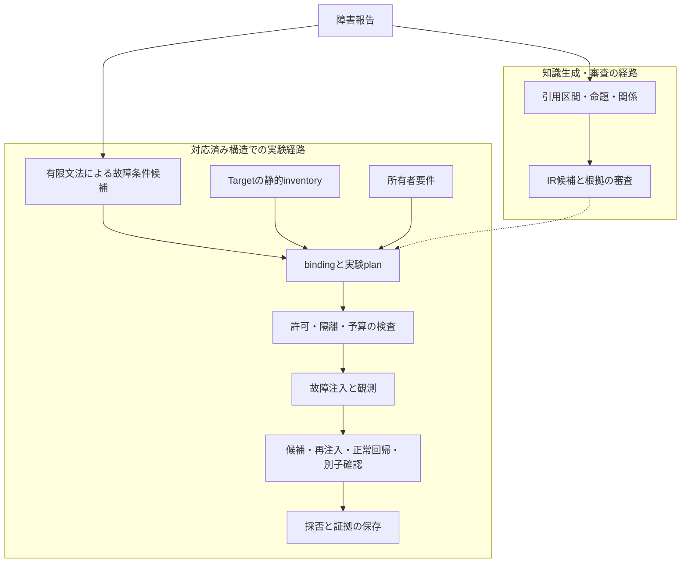

障害報告を読んで「自分のシステムでも起こりそうだ」と思っても、そのまま検証には使えない。故障の成立条件を切り出し、対象のcallerと所有者要件へ結び付け、再現と修復確認まで進める必要がある。この変換を再利用できる形にするため、REQLOXを開発している。

現在は、対応するPython構造と所有者要件を固定し、隔離コピーでの反例の検出、修復候補の適用、同じ故障の再注入、正常回帰、新しい子processでの確認、採否の保存までを実装した。外部の障害知識が未知のTargetの発見・修復を改善するかは、まだ測れていない。

故障注入の結果は主に2026年10月12日JST、Source比較の準備は10月21日JSTの保存記録に基づく。目的、設計判断、実測結果、確認範囲を本記事で説明し、知識抽出とSource比較の評価方法は[深掘り記事](https://zenn.dev/north_to_now/articles/reqlox-evaluation-design)で扱う。

:::message
**この記事での用語**
- **Source**：障害報告などの入力資料。**Target**：検証対象のコード。
- **family**：REQLOXが対応する故障構造の型（atomic file、async resourceなど）。
- **binding**：故障条件を、Targetの特定のcaller・snapshot・呼出し方へ結び付けたもの。
- **profile**：同じTargetに対して、どのcallerをどの要件で検査するかの組。
- **oracle**：観測結果が所有者要件を満たすかを判定する基準。
- **campaign**：一回の隔離実行の単位。予算台帳はこの単位で消費を数える。
- **arm**：比較の各群（Sourceあり／なし）。
- **`HELD`**：bindingや判断の根拠が不足しているため、保留した状態。
:::

# 1. 障害報告は、そのままでは自分の検証に使えない

「ファイル同期に失敗し、一時ファイルが残留した」という報告があったとする。これだけでは、自分のコードが壊れるかどうかも、何を直すべきかも決まらない。

失敗したのはどの操作か。一時ファイルの所有者は誰か。宛先は失敗前の内容を保つべきか。例外は呼出し元へ伝えるべきか。それとも、この対象では失敗後にファイルを残して回収する仕様なのか。

症状が似ていても、求める振る舞いが違えば修復の意味は変わる。そこでREQLOXでは、知識を再利用する単位を、サービス名やエラーメッセージの一致ではなく、故障の成立条件と資源のライフサイクルに置いた。

最初から任意のrepositoryを対象にすると、コードの解釈、仕様の推定、故障の生成、修復の生成の誤りが、一つの結果に混ざってしまう。そこで対応する構造をfamilyに限定し、反例と修復後の変化を追える単位を先に作った。この記事で結果が出てくるのは、atomic file（一時ファイルへの書込みから宛先の置換まで）と、async resource（非同期の資源の取得・処理・解放）の二つである。

この限定には代償がある。実在のOSSが対応する形に収まらず、実験へ進めないことがある。後述するSource比較の準備では、この制約が対象選定の失敗として現れた。

# 2. 具体例：persistの反例から修復確認まで

## 故障を与える前に、守る性質を決める

所有下のexampleに、次の`persist`がある。

```python
def persist(destination: Path, data: bytes) -> None:
    destination.parent.mkdir(parents=True, exist_ok=True)
    pending = destination.with_name(destination.name + f".tmp-{os.getpid()}")
    with pending.open("xb") as output:
        output.write(data)
        output.flush()
        os.fsync(output.fileno())
    os.replace(pending, destination)
```

このcallerの所有者要件として、故障時には次の四つを満たすことを定めた。

1. 旧destinationを保つ
2. 例外を呼出し元へ伝える
3. 今回の呼出しで作成した一時ファイルだけを削除する
4. その後の正常な呼出しを妨げない

すでに存在する一時ファイルは、別の呼出しの所有物として扱う。

`WRITE`、`FSYNC`、`REPLACE`の各境界で例外を与えると、元のコードはpendingを残した。続く正常な呼出しは、同じpathを`xb`で開こうとして`FileExistsError`になる。oracleには、例外を受けた直後の状態だけでなく、残ったファイルが次の呼出しへ与える影響も含めている。

## 所有境界を壊さない修復

修復候補の中心は次の形になる。

```python
temporary_created = False
try:
    with pending.open("xb") as output:
        temporary_created = True
        output.write(data)
        output.flush()
        os.fsync(output.fileno())
    os.replace(pending, destination)
finally:
    if temporary_created:
        pending.unlink(missing_ok=True)
```

flagは、`open("xb")`が成功した後に立てる。既存のpendingがあるせいでopen自体が失敗した場合、この呼出しはそのpathを削除する権利を得ていないからだ。

**採らなかった修正**は、`finally`でpathの存在だけを確かめて削除するものである。これでも故障例は通るが、別の呼出しが所有する一時ファイルまで消してしまい、所有境界を壊す。

この候補は、モデルではなく、familyに対応した決定的なAST書換えで生成した。書換えでは、追加する変数名が既存の名前と衝突する場合は拒否し、変更後のコードをbindingへ入力し直す。外から与えた候補を検査する経路もあるが、ここで紹介する修復を、モデルが新しく考案したものとしては扱わない。[候補生成の実装](https://github.com/yukimurata0421/REQLOX/blob/17866ed918753b18bfacdc0b7ced06c6dd7c4e2e/reqlox_core/repository_atomic_write.py)で、対応する形と書換えの内容を確認できる。

非同期資源のexampleでも、同じ考え方を使う。取得した後の処理だけを`try/finally`に入れる。

```python
await resource.acquire()
try:
    await operation()
finally:
    resource.release()
```

取得待ちの間に取消されたtaskまで無条件にreleaseすると、別のownerが持つ資源を解放してしまうおそれがある。そこで、取得後の例外・取消と、取得待ち中の取消を別の条件にした。このexampleで確認したのは、同期的な`release()`を持つ所有lockのcallerである。

## 結果：検出・修復・再注入

2026年10月12日の隔離実験では、所有下の`api`（`persist`を含む）と`worker`（非同期lockを含む）に、それぞれ4 campaignを実行した。

この実験の入力は、所有者要件と整理済みの故障条件である。説明用の障害報告を起点に条件を自動抽出した実験ではなく、この結果から自然なSourceの追加価値は認定しない。

各Targetの4 campaignは、Source armとNo Source armの各1回と、それぞれの修復後に新しい子processで確認した各1回である。両armは同じTargetと所有者要件を使っており、この実験はSourceの寄与を比べるための設計ではない。

次の表の観測数は、両armと確認工程を合わせた合計である。campaign数とは一致しない。また、同じTargetの同じ候補に対する互いに従属した条件なので、6件の独立した修復を意味しない。

| Target | 初回の故障条件の観測 | うち要件違反 | 候補への再注入 | 正常回帰 | 新しい子processでの故障確認 |
| --- | ---: | ---: | ---: | ---: | ---: |
| api | 6 | 6 | 6/6 | 10/10 | 6/6 |
| worker | 6 | 4 | 6/6 | 2/2 | 6/6 |

`api`では、write・fsync・replaceが失敗した後に一時ファイルが残り、続く呼出しが失敗することを観測した。`worker`では、処理中の例外とtaskの取消で資源が解放されず、次のtaskが取得できなかった。取得待ち中の取消は元の実装でも通っていたため、検出した欠陥には数えていない。候補を採用したのは、各Targetの派生snapshotに限る。

件数は[公開した保存サマリー](https://github.com/yukimurata0421/REQLOX/blob/17866ed918753b18bfacdc0b7ced06c6dd7c4e2e/reqlox_demo/data/archived-records.json)でも確認できる。

## 元のmoduleをつないだcallerでも確かめる

関数を抜き出して再compileした状態で確認した性質が、moduleとして呼び出しても保たれるかを、別途確認した。callerの構成は、`worker`で所有lockを取得し、`temppath`のcontextに入り、bytesを読み書きして、`api.persist`で保存するというものである。read-onlyのbundleから元のmodule全体をimportして実行する。

| 条件群 | 元のコピー | 既存の候補 | 新しい子processで同じ候補を確認 |
| --- | ---: | ---: | ---: |
| 故障5条件 | 0/5 PASS | 5/5 PASS | 5/5 PASS |
| 正常4条件 | 4/4 PASS | 4/4 PASS | 4/4 PASS |
| 既存pendingの所有境界 | 0/1 PASS | 1/1 PASS | 1/1 PASS |

故障条件は、write・fsync・replaceでの例外、persist前のoperationでの例外、taskの取消の五つである。正常条件は、通常・空・NUL・Unicodeのbytesを使った。元のコピーでは、故障条件のうち3件でapiのpendingが残った。また、故障5件と所有境界1件でworkerのlockが解放されず、次の正常な呼出しがtimeoutした。

この実験で確かめたのは、既存の候補による改善が統合callerでも保たれることである。新しい修復候補の生成や、`temppath`の修復は行っていない。実装は[統合callerの実装](https://github.com/yukimurata0421/REQLOX/blob/17866ed918753b18bfacdc0b7ced06c6dd7c4e2e/reqlox/integration_worker.py)、結果は[有限結果の記録](https://github.com/yukimurata0421/REQLOX/blob/17866ed918753b18bfacdc0b7ced06c6dd7c4e2e/docs/copied-module-integration.md)で公開している。

# 3. 設計の核：三つの問いを分ける

前節の実験では、整理済みの条件と所有者要件を使った。これを外部の障害報告へ広げるには、三つの問いに別々の根拠を与える必要がある。

| 問い | 主な入力 | 判断すること |
| --- | --- | --- |
| 原文は何を支持しているか | 障害報告、引用区間 | 故障条件や因果関係の主張が、原文に支えられているか |
| その条件を対象に与えられるか | Targetのsnapshot、構文、公開APIの仕様 | 対応するcallerと注入位置を固定できるか |
| 何を満たせば修復とするか | 所有者要件、観測項目 | 候補が故障時と正常時の要件を満たすか |

Sourceから得られるのは故障の仮説にすぎない。対象の所有者要件は、別の入力として与える。

この分離がないとどうなるか。Sourceに「削除を再試行すべきだった」と書かれているだけで対象にも再試行を要求し、それを満たす修正を成功と判定できてしまう。対象の既存仕様が「一回だけ試行し、例外を伝える」ことを求めているなら、その修正は仕様の変更である。

実装でも、知識の生成・審査の経路と、Targetに対する実験の経路を分けた。



破線は、一般的な知識移転としてはまだ実証できていない接続を表す。実際に動いている実験経路では、Sourceを条件に変換するために、限定した字句文法を使っている。

**採らなかった構成**は、モデルが生成・審査したIRで、そのまま任意のTargetを実行するものである。審査の確率や適用可否の判断は、実行権限に変換しない。実行するには、対象の同一性、対応するbinding、実験の許可、隔離、残りの予算という別の条件を満たす必要がある。こうすることで、意味解釈の不確実さと、実行できる操作の範囲を別々に扱える。

## Target側：importせずに、実行できる対象を絞る

Targetを調べる入口では、moduleをimportしない。構文から対応する関数やcontextを列挙し、引数、呼出し、資源の取得と解放、公開APIの記述などを照合する。importに伴う初期化や外部接続が、inventoryの作成中に起きないようにするためである。

bindingは単なるsymbol名ではなく、snapshot、member、コード、呼出し方、適用する条件を結び付けたものにする。候補コードを作った後は、派生snapshotを探索し直し、束縛し直したコードが実際の候補と一致することを確かめる（[静的inventoryとbindingの実装](https://github.com/yukimurata0421/REQLOX/blob/17866ed918753b18bfacdc0b7ced06c6dd7c4e2e/reqlox_core/reliability_reuse.py)）。

対応できる構造は実装を足せば増やせる。ただしそのたびに「どのcallerを、どの要件で検査できるか」を定義し直す必要がある。対象ごとの例外処理を足し続けると、知識の再利用よりも、手書きのadapterが結果を左右するようになる。そのため、familyごとの対応範囲と保留の理由を、結果に残すことにした。

# 4. 判定の順序と、保留の扱い

## 修復成功と呼ぶまでにそろえる観測

| 段階 | 見るもの |
| --- | --- |
| 正常baseline | 元のコードが、通常の入力で所有者要件を満たすか |
| 故障時の反例 | 指定した条件に到達し、どの要件が破られたか |
| 候補への再注入 | 同じ故障条件で、違反が解消したか |
| 正常回帰 | 通常・空・NUL・Unicodeなどの入力を壊していないか |
| 所有境界 | 既存のpendingや無関係なfileを残しているか |
| 新しい子processでの確認 | 候補と条件を固定したまま、別のprocessでも確認できるか |

判定の順序もコードに入れている。正常baselineが成り立たなければ`BASELINE_INVALID`、指定した故障に到達したと判定できなければ`FAULT_NOT_REACHED`を、他の判定より優先する。そのうえで、反例の有無、候補を実行したか、再注入と回帰が通ったかを評価する。

この判定経路では、故障への未到達や正常baselineの不成立を、候補の修復結果より先に扱う（[観測の分類と候補検査](https://github.com/yukimurata0421/REQLOX/blob/17866ed918753b18bfacdc0b7ced06c6dd7c4e2e/reqlox_core/reliability_reuse_worker.py)）。

## 同じライブラリでも、profileによって結論が変わる

`temppath`では、atomic bindingの4箇所を`HELD`にした。保留の理由は`SERIALIZED_MODULE_IMPORT`と`INSTANCE_DYNAMIC_PROTOCOL`である。再exportされたsymbolや、instanceの特殊methodを、当時のatomic writer向けのbindingでは確定できなかった。

一方、READMEに基づくpath-context用の別profileでは、次の三つを検査できた。通常の終了時に所有pathを削除すること、bodyで起きた例外を伝えること、無関係なfileを残すことである。2 campaignで、正常系と反復4件、bodyでの故障と反復8件が通り、無変更コードの確認12件も通った。結果は、固定した要件と条件の範囲での`NO_COUNTEREXAMPLE`である。

この二つの結果は両立する。ライブラリが同じでも、検査するcallerと要件が違うからだ。READMEに削除失敗時の再試行の保証が書かれていなければ、外部の障害報告だけを根拠にその保証を付け足し、既存実装の不具合として数えることはできない。

`HELD`は、指定したbindingや判断の根拠が足りず、保留している状態を表す。保留を解くには、対応する呼出し方と要件を確定し、そのprofileとして検証し直す必要がある。

# 5. 実験の範囲と、結果の同一性を固定する

実験の結果を再利用するには、結果だけでなく、どの対象にどの方法で得た結果なのかを固定しておく必要がある。保存記録では、次のものを互いに結び付けている：Sourceの根拠区間、Targetのsnapshot、所有者要件、binding、故障条件、候補コード、plan、method、観測結果。候補は派生snapshotに適用し、元のTargetには手を加えない。[保存結果を読む公開UI](https://reqlox.yukimurata0421.dev/demo/)は、保存済みのstageの表示を切り替えるだけで、新しい故障注入や修復は始めない。

実験のcampaignは、起動前に永続的な台帳へ予約する。起動に失敗した場合や結果が分からない場合も、消費として残す。同じ入力を別のrun名で指定しても、消費した枠は取り戻せない。失敗した実験が集計から消えると、成功率と消費量の両方を見誤るからである。コピー実験のscopeの台帳は、それ以前の12 campaignと統合callerの3 campaignを合わせた15/15、charge 62/120秒で閉じている。chargeは予約した消費量であり、実測した所要時間ではない。

:::details 実行の隔離と資源の上限
namespaceで分離した、root権限を持たない子processで実行する。homeやcredentialはTargetに渡さず、networkも分離した。

| 資源 | 上限 |
| --- | ---: |
| CPU時間 | 2秒 |
| wall time | 5秒 |
| address space | 128MiB |
| file size | 128KiB |
| core dump | 0 |
:::

保存記録のhashは、別の内容の混入や入力のdriftを検知するためのものである。hashが一致しても、観測が真実であることや、第三者による実行、独立したtimestampまでは証明できない。紹介したコピー実験の集約監査は、保存結果を照合するだけで、Targetを新たに実行しない。一方、公開packageの監査の一部は、hashの照合後に保存したmethodをimportする。そのため、受け取った任意のbundleを、hashが合うという理由だけで信頼する用途には使えない。

過去の一部の起動ではraw logが失われており、`UNKNOWN_UNRECOVERED`として残している。同じ条件で後日実行しても、失われた起動の観測を復元したことにはならない。

# 6. 確認できたことと、次に測る効果

ここまでの結果を、対象と要件を固定した機構の確認と、今後測る効果に分ける。

| 問い | 現在の結果 |
| --- | --- |
| 既知の所有下コードで反例を検出し、候補の改善を確認できたか | api・workerの隔離コピーと統合callerで、固定した条件の下で確認した |
| temppathを修復したか | 修復は行っていない。README条件では反例なし、atomic bindingは4箇所がHELD |
| 自然なSourceを与えると発見・修復が改善するか | 未測定。2026年10月21日の比較準備は対象条件が成立せず、native campaign 0で止まった |
| 未使用OSSへ一般化し、人の作業を減らせるか | 一般化は未実証、人的負担の削減量は未計測 |

故障注入で直接確かめたのは、隔離したPythonコードの呼出しと、選んだ操作境界への例外・取消である。常時稼働するHTTPサービス全体や物理diskの故障を試した結果にはならない。cleanup自体の失敗、第三者によるpathの差替え、process crashや電源断への永続性も、別の故障条件と要件が必要になる。

次の問いは、外部の障害知識が、同じprimitiveと予算を使うSourceなしの探索より、早く有効な反例へ到達させるかである。既知の修復規則を持つ両armが同じ条件を全探索した最終件数だけでは、この寄与を識別できない。

そのため、Targetの情報を使えるSourceなしplannerを対照に置き、所有者要件・修復方針・確認条件・予算をそろえて比較する設計を用意した。実Targetの比較は、対応するcallerとSourceの条件化が同時に成立する対象を得られず、実行へ進んでいない。比較器の合成検査、対象選定の停止、現実のSource効果を別々の結果として残している。

REQLOXで作ったのは、対応する構造と要件の下で、故障条件をcallerへ結び付け、反例から候補の再確認までを追える検証経路である。この経路を外部知識の横展開へ広げるために、対応範囲の実装と、その範囲での効果測定を分けて進める。人的負担についても、人による条件化・実験作成・訂正・修復確認の時間と総費用を測る必要がある。

[深掘り記事「REQLOXの評価設計」](https://zenn.dev/north_to_now/articles/reqlox-evaluation-design)では、未確定labelを分母に残したpaired Brier、生成の反復安定性、Sourceあり／なしの対照設計と、今回測れなかったことを詳しく扱う。

---

公開コードは[REQLOX](https://github.com/yukimurata0421/REQLOX)、保存結果は[read-only review](https://reqlox.yukimurata0421.dev/demo/)で確認できる。本文のコード参照は公開revision `17866ed`に固定した。公開UIは保存済み結果の閲覧であり、新しいTarget実験は開始しない。
